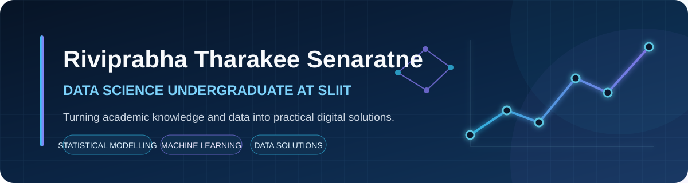

  

   

  
  

## About Me

I am a Data Science undergraduate at the Sri Lanka Institute of Information Technology, interested in transforming data and academic ideas into practical digital solutions. My project experience spans statistical modelling, intelligent healthcare systems, mobile applications, and Java-based information systems.

- 📊 Interested in statistical analysis, predictive modelling, and responsible data-driven solutions
- 🌱 Strengthening my practical skills in Python, SQL, machine learning, and reproducible analysis
- 🤝 Experienced in collaborative academic development and clear technical documentation
- 🎯 Focused on turning academic work into credible, portfolio-ready case studies

## Featured Projects

<table>
  <tr>
    <td width="50%" valign="top">
      <h3>📊 Employee Absenteeism Analysis</h3>
      
A statistical modelling consultancy project based on 8,336 employee records, combining data-quality assessment, exploratory analysis, statistical testing, regression, and model evaluation.

      
<code>Statistical Modelling</code> <code>EDA</code> <code>Regression</code>

    </td>
    <td width="50%" valign="top">
      <h3>🏥 <a href="https://github.com/Ruchira-Rukshan/CareLink-Platform">CareLink Platform</a></h3>
      
An integrated healthcare ecosystem connecting patients, doctors, laboratories, pharmacies, and suppliers. I developed the Pharmacy Dispensing Unit workflows.

      
<code>React</code> <code>Spring Boot</code> <code>Python</code> <code>MySQL</code>

    </td>
  </tr>
  <tr>
    <td width="50%" valign="top">
      <h3>📍 <a href="https://github.com/GeethDhananjaya/Mobile_App">Hidden Places</a></h3>
      
A mobile application for discovering and sharing lesser-known destinations across Sri Lanka. My responsibility focused on Travel Guide Management.

      
<code>React Native</code> <code>Expo</code> <code>Node.js</code> <code>MongoDB</code>

    </td>
    <td width="50%" valign="top">
      <h3>🧳 <a href="https://github.com/it24103552/TripSystem">TripSystem</a></h3>
      
A collaborative Java travel-booking system. My public contribution history includes the Java and JSP components supporting booking functionality.

      
<code>Java</code> <code>JSP</code> <code>Spring Boot</code> <code>MySQL</code>

    </td>
  </tr>
</table>

## Technologies Used in My Projects

### Data and Intelligent Systems

### Application Development

### Databases and Tools

## Current Focus

- Building stronger foundations in statistical analysis and predictive modelling
- Developing practical data-analysis workflows with Python and SQL
- Creating reproducible projects with clear documentation
- Presenting academic work through concise technical case studies

## Connect

I am interested in learning from others, exploring thoughtful project ideas, and growing through collaborative technical work.

[LinkedIn](https://www.linkedin.com/in/riviprabha-tharakee-senaratne-3aa402224/) · [GitHub](https://github.com/RTSenaratne) · [University GitHub](https://github.com/IT24103526)
